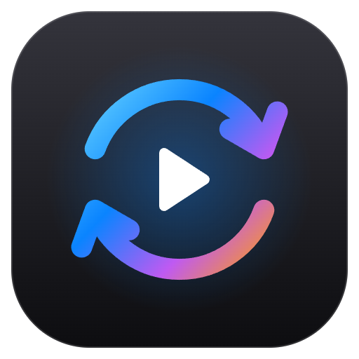
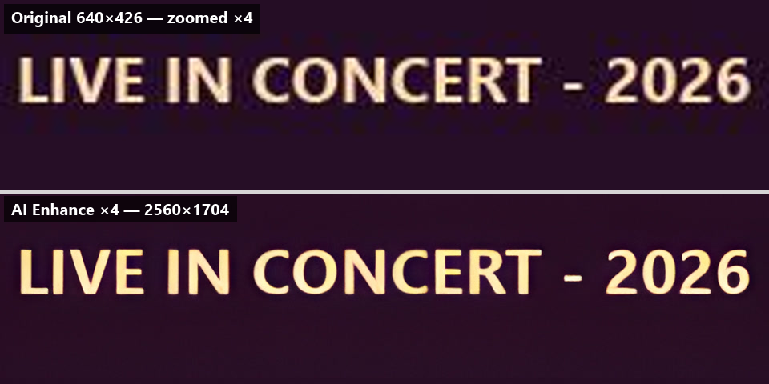
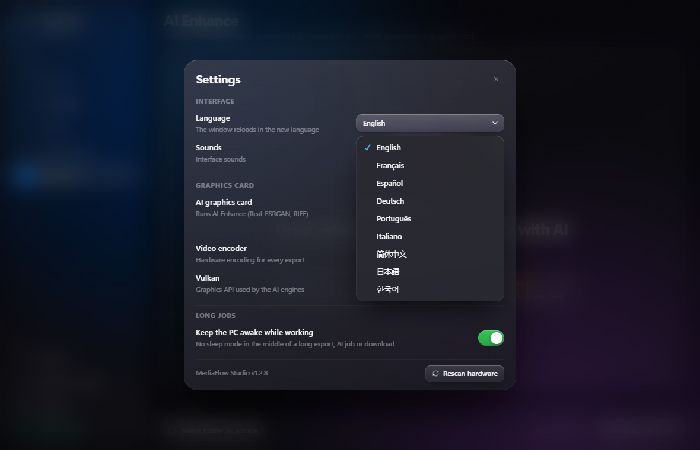

<div align="center">



# MediaFlow Studio

**Convert · Download · Trim · Extract · Enhance**

An everyday media toolkit for **video editors** — one fast, offline Windows app with a dark *liquid glass* interface.
Install it in two clicks: everything is included, nothing else to set up.


[](https://github.com/Noxuu58/mediaflow-studio/releases/latest)

<br>

[](https://github.com/Noxuu58/mediaflow-studio/releases/latest/download/MediaFlow-Studio-Setup.exe)

<sub>or the <a href="https://github.com/Noxuu58/mediaflow-studio/releases/latest/download/MediaFlow-Studio-Portable.exe">portable version</a> (no install)</sub>

<br><br>


</div>

<br>

## Tools

| | Tool | What it does |
| :-- | :-- | :-- |
| 🔄 | **Converter** | One-click presets — **TikTok / Shorts**, **Clean export (YouTube)**, **Proxy for editing (ProRes)**, **Extract audio** — or any format. Variable frame rate is detected and fixed, HDR is tone-mapped for 8-bit deliveries, 10-bit and timecode are kept, and **GPU encoding** (NVIDIA / Intel / AMD) is used automatically. **Advanced** mode unlocks ProRes / DNxHR, bit depth, frame rate, resolution and audio-track control. |
| ⬇️ | **Downloader** | Paste a link from YouTube, TikTok, Instagram, X, Vimeo, SoundCloud and 1,000+ sites. Video or audio, in the quality you choose — H.264 + AAC preferred so it drops straight into your editor. |
| ✂️ | **Trimmer** | Preview, filmstrip timeline, in / out handles. **Fast** mode cuts instantly without re-encoding; **Frame-accurate** mode re-encodes at maximum quality. |
| 🎧 | **Audio Extractor** | Pull the audio out of any video as `WAV` `MP3` `FLAC` `M4A`, with **loudness normalization** (−14 / −16 / −23 LUFS), noise reduction and low-cut. Advanced: pick or mix tracks, mono, **split L / R** (lav + camera mic), 24-bit, 48 kHz. |
| 🪄 | **AI Enhance** | Two modes, 100% local on your graphics card: **Upscaling** with Real-ESRGAN (videos 720p → 4K — even at the same size it rebuilds detail and removes compression blocks — and **photos and images ×2 / ×3 / ×4** in PNG, JPG or WebP, transparency kept) and **Interpolation** with RIFE (smooth motion up to 240 fps — 60, 120, 180 or 240). Lower targets are a classic downscale / frame drop. |

<div align="center">


</div>

<div align="center">

<br><sub><b>AI Enhance</b> — Real-ESRGAN upscaling for videos and images, RIFE interpolation, running locally on your GPU. Each file shows what it will become before you start, and only the settings your files use are shown.</sub>
</div>

<div align="center">

<br><sub><b>Image upscaling ×4</b> — top: the original, simply zoomed. Bottom: AI Enhance. Sharp edges, no blur, JPEG artifacts cleaned up.</sub>
</div>

<br>

<div align="center">

<br><sub><b>Advanced mode</b> — one click away, never in the way: codecs, bit depth, frame rate, audio tracks, GPU.</sub>
</div>

<br>

| | Also |
| :-- | :-- |
| ⚙️ | **Settings** (<kbd>Ctrl</kbd> + <kbd>,</kbd>) — language, sounds, the graphics card for AI, the video encoder (NVENC / Quick Sync / AMF / CPU), your Vulkan version, keep the PC awake during long jobs |
| 🧯 | Closing the window while a job runs asks first — no export lost by accident |
| 🩺 | Clear messages when a graphics card can't run the AI — with a link to the right driver |
| 🌍 | 9 languages — English, Français, Español, Deutsch, Português, Italiano, 简体中文, 日本語, 한국어 (switch in Settings) |
| 🔔 | Windows notifications + taskbar progress |
| 🔊 | Soft UI sounds (mute them in Settings) |
| 🛡️ | Never overwrites a file — `name (1).mp4` |
| 📁 | Output folder per tool, remembered |

<div align="center">

<br><sub><b>Settings</b> — 9 languages, each listed under its own name.</sub>
</div>

## Installation

**1. Download**

| | |
| :-- | :-- |
| ⭐ **[MediaFlow-Studio-Setup.exe](https://github.com/Noxuu58/mediaflow-studio/releases/latest/download/MediaFlow-Studio-Setup.exe)** | Recommended. Installs for your account — no admin rights — and adds a desktop shortcut. |
| 📦 [MediaFlow-Studio-Portable.exe](https://github.com/Noxuu58/mediaflow-studio/releases/latest/download/MediaFlow-Studio-Portable.exe) | No install. Run it from anywhere, even a USB drive. |

**2. Run it**

Double-click the file, click **Install**, done. FFmpeg and yt-dlp are built in — you never need a command line.

> **Windows protected your PC?** The app isn't code-signed yet, so SmartScreen may warn on first launch. Click **More info → Run anyway**.

**3. Stay up to date — automatically**

When a new version is out, the app shows an *Update available* banner: one click downloads it in the background, a second one restarts on the new version. You can also click **Check for updates** in the sidebar.

Sites change often: if a link stops working, click **Update** at the bottom of the Downloader to refresh the built-in yt-dlp.

**Uninstall** from *Settings → Apps → MediaFlow Studio*, like any other app.

## Shortcuts

| Keys | Action |
| :-- | :-- |
| <kbd>Ctrl</kbd> + <kbd>O</kbd> | Add files |
| <kbd>Ctrl</kbd> + <kbd>Enter</kbd> | Start (convert · extract · export · download) |
| <kbd>Esc</kbd> | Cancel |
| <kbd>Ctrl</kbd> + <kbd>,</kbd> | Settings |
| <kbd>Ctrl</kbd> + <kbd>V</kbd> | Paste a link (Downloader) |
| <kbd>Space</kbd> | Play / pause (Trimmer) |
| <kbd>I</kbd> · <kbd>O</kbd> | Set in / out point (Trimmer) |
| <kbd>←</kbd> <kbd>→</kbd> | One frame · with <kbd>Shift</kbd> one second (Trimmer) |

## For developers

<details>
<summary><b>Build from source</b></summary>

<br>

Requires Node.js 20+ on Windows.

```powershell
git clone https://github.com/Noxuu58/mediaflow-studio.git
cd mediaflow-studio
npm ci
npm start          # run the app
npm test           # test suite
npm run dist       # → dist/MediaFlow-Studio-Setup.exe + dist/MediaFlow-Studio-Portable.exe
```

`npm run dist` downloads the official `yt-dlp.exe` and checks it against the release's SHA-256 checksums before bundling it.
If `npm` blocked Electron's install script, run `node node_modules/electron/install.js` once.

</details>

<details>
<summary><b>Publish a release</b></summary>

<br>

```powershell
npm version patch          # 1.0.0 → 1.0.1
git push
git push --tags            # the tag starts .github/workflows/release.yml
```

GitHub Actions tests, builds and publishes the release; installed apps then offer the update automatically.
Full guide: **[RELEASING.md](RELEASING.md)**.

</details>

<details>
<summary><b>Project structure</b></summary>

<br>

```
src/
  main.js           Electron main process
  convert.js        FFmpeg engine — convert, trim, extract, preview strip
  download.js       yt-dlp engine (uses Electron's built-in Node for YouTube)
  i18n.js           translation engine (picks the language, fills {placeholders}, plurals)
  locales/          one file per language: en · fr · es · de · pt · it · zh · ja · ko
  sfx.js            UI sounds, synthesized (no audio files)
  app.js            sidebar, navigation, drag & drop, shared helpers
  settings.js       Settings panel (language, sounds, graphics card, encoder, Vulkan, keep awake)
  ai.js             AI engine — Real-ESRGAN + RIFE (ncnn / Vulkan), GPU detection
  styles.css        the whole design system
  tools/
    queue.js        reusable file queue (Converter, Audio Extractor, AI Enhance)
    converter.js · downloader.js · trimmer.js · extractor.js · enhancer.js
build/              icon, installer artwork, installer.nsh
scripts/            fetch-ytdlp.js
test/               node:test suites
```

**Add a tool** — a new file in `src/tools/` calling `App.register({...})` + one `<script>` line in `index.html`.
**Add a language** — copy `src/locales/en.js`, translate it, add its `<script>` line in `index.html` and its code to `ORDER` in `src/i18n.js`. `npm test` checks that no key is missing.

</details>

## Credits

[FFmpeg](https://ffmpeg.org) (GPL-3.0) · [yt-dlp](https://github.com/yt-dlp/yt-dlp) (Unlicense) · [Real-ESRGAN](https://github.com/xinntao/Real-ESRGAN) (BSD-3-Clause) · [RIFE ncnn Vulkan](https://github.com/nihui/rife-ncnn-vulkan) (MIT) · [Electron](https://www.electronjs.org) (MIT) — all bundled in the app.

Only download content you have the right to download.

<br>

<div align="center">
<sub>Made with ♥ for video editors.</sub>
</div>
