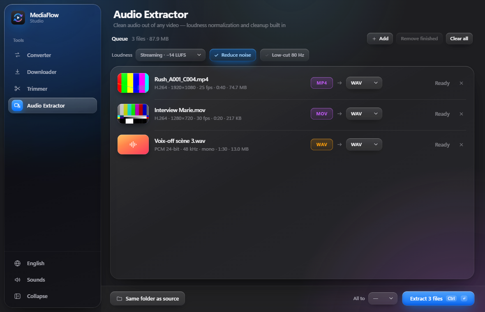

<div align="center">


# MediaFlow Studio

**Convert · Download · Trim · Extract**

An everyday media toolkit for **video editors** — one fast, offline Windows app with a dark *liquid glass* interface.


[](https://github.com/Noxuu58/mediaflow-studio/releases/latest)

<br>


</div>

<br>

## Tools

| | Tool | What it does |
| :-- | :-- | :-- |
| 🔄 | **Converter** | Images `PNG` `JPG` `WebP` · audio `MP3` `WAV` `FLAC` `M4A` · video `MP4` `MKV` `MOV` `WebM`. Video → video is a **lossless remux** whenever possible. Drag & drop, queue, per-file progress and ETA. |
| ⬇️ | **Downloader** | Paste a link from YouTube, TikTok, Instagram, X, Vimeo, SoundCloud and 1,000+ sites. Video or audio, in the quality you choose — H.264 + AAC preferred so it drops straight into your editor. |
| ✂️ | **Trimmer** | Preview, filmstrip timeline, in / out handles. **Fast** mode cuts instantly without re-encoding; **Frame-accurate** mode re-encodes at maximum quality. |
| 🎧 | **Audio Extractor** | Pull the audio out of any video as `WAV` `MP3` `FLAC` `M4A`, with **loudness normalization** (−14 / −16 / −23 LUFS), noise reduction and low-cut. |

<div align="center">



</div>

<br>

| | Also |
| :-- | :-- |
| 🌍 | English & French interface |
| 🔔 | Windows notifications + taskbar progress |
| 🔊 | Soft UI sounds (one click to mute) |
| 🛡️ | Never overwrites a file — `name (1).mp4` |
| 📁 | Output folder per tool, remembered |

## Installation

**1. Download the app**

Grab `MediaFlow-Studio-<version>-portable.exe` from the [latest release](https://github.com/Noxuu58/mediaflow-studio/releases/latest) and run it. No installer, FFmpeg is built in.

> Windows may show a SmartScreen warning the first time (the app is not code-signed): click **More info → Run anyway**.

**2. For the Downloader only — install yt-dlp**

```powershell
winget install yt-dlp.yt-dlp DenoLand.Deno
```

`yt-dlp` stays separate so you can update it whenever a site changes (button **Update** in the app). `Deno` is required by YouTube.

## Shortcuts

| Keys | Action |
| :-- | :-- |
| <kbd>Ctrl</kbd> + <kbd>O</kbd> | Add files |
| <kbd>Ctrl</kbd> + <kbd>Enter</kbd> | Start (convert · extract · export · download) |
| <kbd>Esc</kbd> | Cancel |
| <kbd>Ctrl</kbd> + <kbd>V</kbd> | Paste a link (Downloader) |
| <kbd>Space</kbd> | Play / pause (Trimmer) |
| <kbd>I</kbd> · <kbd>O</kbd> | Set in / out point (Trimmer) |
| <kbd>←</kbd> <kbd>→</kbd> | One frame · with <kbd>Shift</kbd> one second (Trimmer) |

## Build from source

```powershell
git clone https://github.com/Noxuu58/mediaflow-studio.git
cd mediaflow-studio
npm ci
npm start          # run the app
npm test           # test suite
npm run dist       # → dist/MediaFlow-Studio-<version>-portable.exe
```

> If `npm` blocked Electron's install script, run `node node_modules/electron/install.js` once.

<details>
<summary><b>Project structure</b></summary>

<br>

```
src/
  main.js           Electron main process
  convert.js        FFmpeg engine — convert, trim, extract, preview strip
  download.js       yt-dlp engine
  i18n.js           translations (en, fr)
  sfx.js            UI sounds, synthesized (no audio files)
  app.js            sidebar, navigation, drag & drop, shared helpers
  styles.css        the whole design system
  tools/
    queue.js        reusable file queue (Converter + Audio Extractor)
    converter.js · downloader.js · trimmer.js · extractor.js
test/               node:test suites
```

**Add a tool** — a new file in `src/tools/` calling `App.register({...})` + one `<script>` line in `index.html`.
**Add a language** — copy the `en` block in `src/i18n.js` and translate it.

</details>

## Credits

[FFmpeg](https://ffmpeg.org) (bundled, GPL-3.0) · [yt-dlp](https://github.com/yt-dlp/yt-dlp) (not bundled) · [Electron](https://www.electronjs.org)

Only download content you have the right to download.

<br>

<div align="center">
<sub>Made with ♥ for video editors.</sub>
</div>
